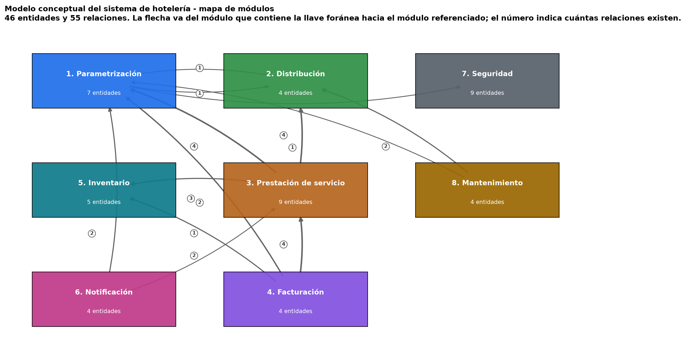
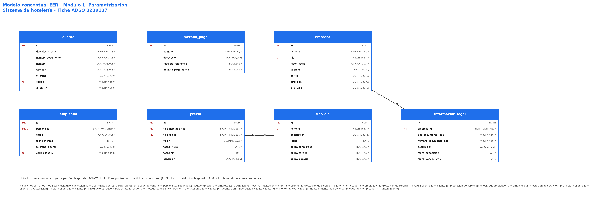
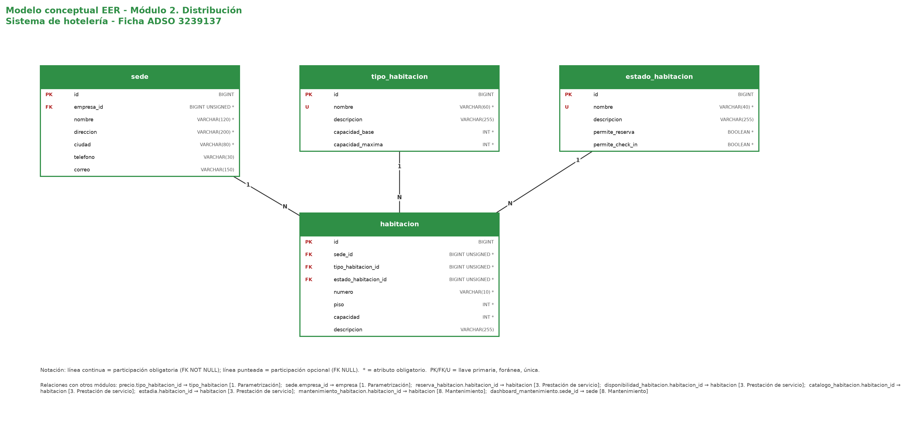
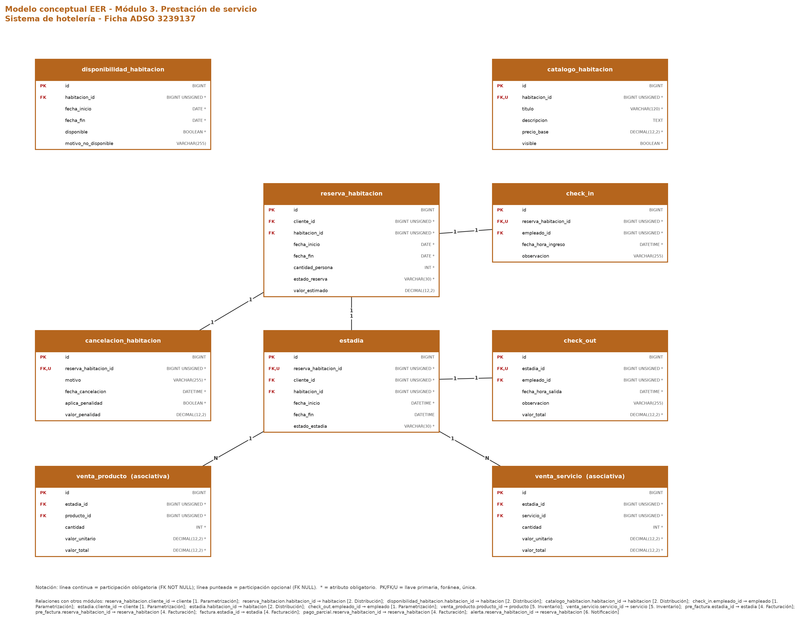
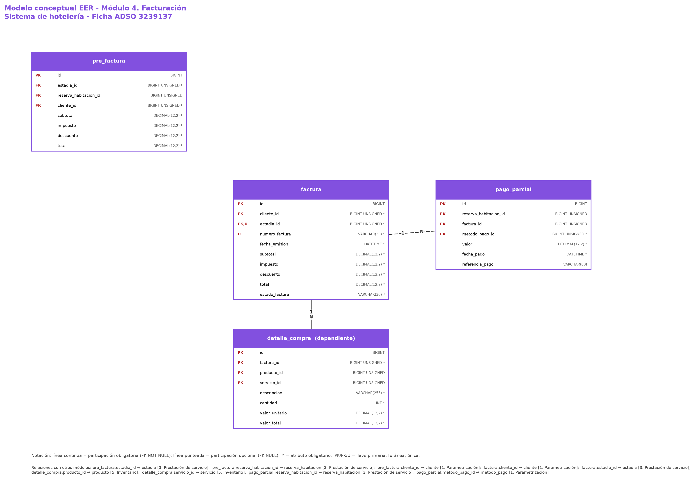
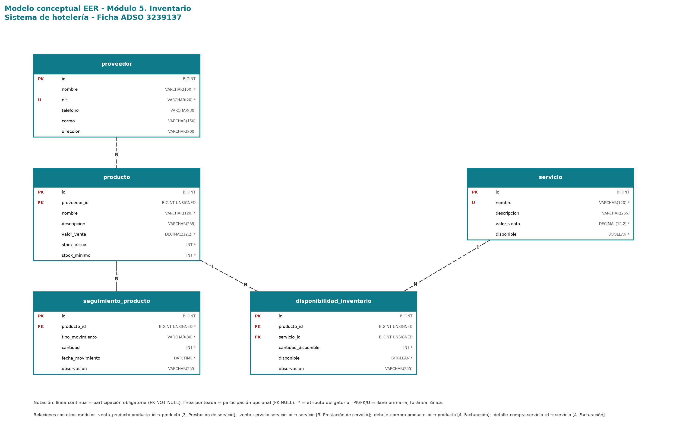
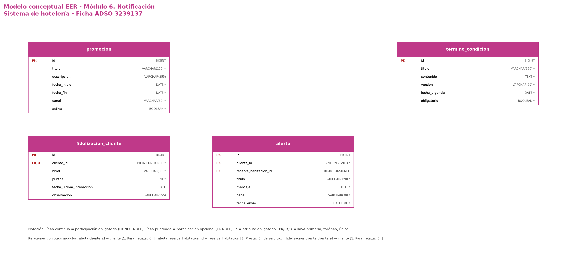
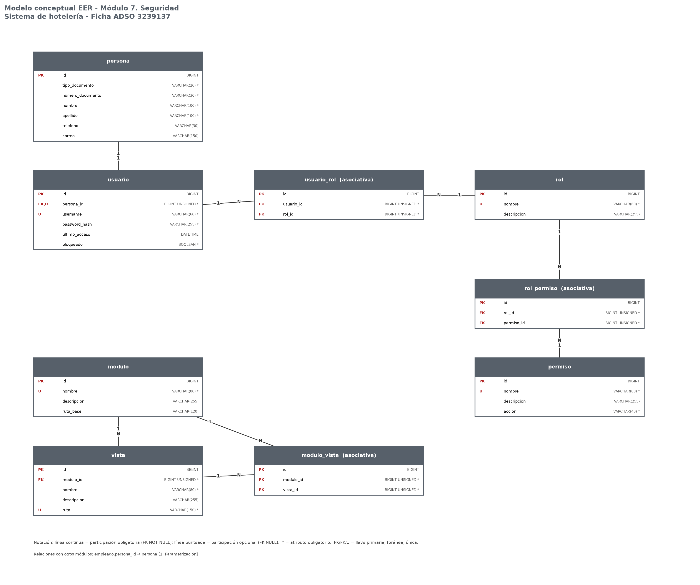
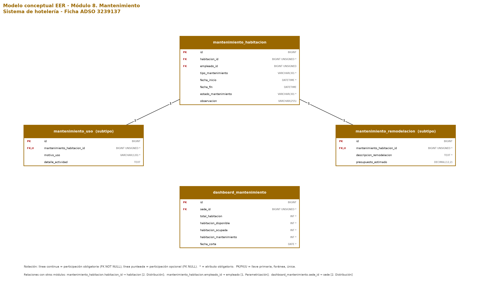

# Modelo conceptual de la base de datos - Sistema de hotelería

**Evidencia GA3-220501096-AA1-EV01**

| Campo | Valor |
|---|---|
| Programa de formación | Análisis y Desarrollo de Software (ADSO) - Código 228118 |
| Ficha | 3239137 |
| Proyecto formativo | Desarrollo de software orientado a servicios |
| Fase | Ejecución |
| Competencia | 220501096 - Desarrollar la solución de software de acuerdo con el diseño y metodologías de desarrollo. |
| Resultado de aprendizaje | 593107-02 - Construir la base de datos para el software a partir del modelo de datos. |
| Actividad | GA3-220501096-AA1 - Construir el modelo conceptual de la base de datos del proyecto a partir del modelo de datos del diseño. |
| Evidencia | GA3-220501096-AA1-EV01 - Modelo conceptual de la base de datos del proyecto formativo. |
| Aprendiz | Johan Otavo |
| Instructor | Jesús Ariel González Bonilla |
| Ciudad y fecha | Neiva, 1 de septiembre de 2026 |

## 1. Introducción

Este documento presenta el modelo conceptual de la base de datos del sistema de hotelería, proyecto formativo de la ficha ADSO 3239137. Corresponde a la evidencia GA3-220501096-AA1-EV01 de la actividad de aprendizaje GA3-220501096-AA1 y da continuidad al modelo de datos elaborado en la fase de diseño.

El insumo de este trabajo son los documentos de arquitectura del modelo de datos elaborados en la semana 10 del proceso formativo: el entendimiento de la necesidad del producto, las funcionalidades posibles por módulo, la estructura de módulos y entidades, la estructura de entidades con sus atributos y la definición del identificador y de los campos de auditoría. Sobre esa base, el aporte de esta evidencia es la definición de los tipos de datos, las llaves, las restricciones de integridad y, principalmente, las relaciones y cardinalidades que aún no estaban representadas.

## 2. Objetivos

### 2.1 Objetivo general

Construir el modelo conceptual de la base de datos del sistema de hotelería a partir del modelo de datos del diseño, representándolo en un diagrama entidad-relación extendido (EER) elaborado con una herramienta CASE.

### 2.2 Objetivos específicos

1. Representar las 46 entidades de los 8 módulos del sistema con sus atributos, tipos de datos y restricciones.
2. Definir las llaves primarias, las llaves candidatas y las llaves foráneas de cada entidad.
3. Establecer las relaciones entre entidades con su cardinalidad, su participación y su acción referencial.
4. Resolver las relaciones muchos a muchos mediante entidades asociativas y representar las especializaciones propias del modelo EER.
5. Validar la completitud y la coherencia del modelo frente a la especificación de requisitos del proyecto.
6. Documentar el modelo y las decisiones de diseño como insumo del modelo físico (GA3-220501096-AA2-EV02).

## 3. Alcance

El alcance de esta evidencia es el modelo conceptual: entidades, atributos, dominios, llaves, restricciones y relaciones, expresados de forma independiente de la explotación física de la base de datos. La creación efectiva de la base de datos en el SGBD, los índices de rendimiento, las vistas, los procedimientos almacenados y las pruebas de integridad referencial corresponden a la actividad GA3-220501096-AA2.

Se conservan íntegramente las entidades y los atributos definidos en el modelo de datos del diseño. No se eliminó ninguna entidad; cuando se detectó una posible redundancia se documentó como decisión de diseño para resolverla con el instructor antes de la implementación física.

## 4. Metodología y herramientas

El modelo se construyó en cuatro pasos. Primero se analizaron los documentos del modelo de datos del diseño para extraer entidades y atributos. Segundo, se asignó a cada atributo su tipo de dato, su obligatoriedad y su rol de llave. Tercero, se dedujeron las relaciones a partir de los atributos de referencia (los que terminan en _id), se definieron sus cardinalidades y se agregaron las relaciones que faltaban. Cuarto, se verificó el modelo contra las funcionalidades del diseño mediante una matriz de trazabilidad.

El diagrama EER se construye en MySQL Workbench 8.0 mediante ingeniería inversa del script modelo_conceptual_hotel.sql que acompaña esta evidencia, siguiendo la ruta File > Import > Reverse Engineer MySQL Create Script, con la opción "Place imported objects on a diagram" activada. Ese procedimiento produce el diagrama EER con notación de pata de gallo, que es la notación estándar de la herramienta.

Para que el modelo y su documentación no se desactualicen entre sí, las entidades y las relaciones se declararon una sola vez en los archivos modelo_datos.py y modelo_relaciones.py, y a partir de ellos se generan el script SQL, el diccionario de datos, la tabla de relaciones y los diagramas de este informe. Los mismos archivos verifican de forma automática que cada llave foránea tenga una relación declarada, que la opcionalidad coincida y que toda relación 1:1 tenga su restricción UNIQUE.

## 5. Estructura general del modelo

El modelo conceptual está conformado por 46 entidades organizadas en 8 módulos y relacionadas entre sí mediante 55 relaciones. La siguiente figura muestra los módulos y la cantidad de relaciones que existen entre ellos.

*Figura 1. Mapa de módulos del modelo conceptual del sistema de hotelería.*

**Tabla 1. Entidades por módulo.**

| Módulo | Entidades | Detalle |
|---|---|---|
| 1. Parametrización | 7 | cliente, empleado, empresa, informacion_legal, metodo_pago, precio, tipo_dia |
| 2. Distribución | 4 | estado_habitacion, habitacion, sede, tipo_habitacion |
| 3. Prestación de servicio | 9 | cancelacion_habitacion, catalogo_habitacion, check_in, check_out, disponibilidad_habitacion, estadia, reserva_habitacion, venta_producto, venta_servicio |
| 4. Facturación | 4 | detalle_compra, factura, pago_parcial, pre_factura |
| 5. Inventario | 5 | disponibilidad_inventario, producto, proveedor, seguimiento_producto, servicio |
| 6. Notificación | 4 | alerta, fidelizacion_cliente, promocion, termino_condicion |
| 7. Seguridad | 9 | modulo, modulo_vista, permiso, persona, rol, rol_permiso, usuario, usuario_rol, vista |
| 8. Mantenimiento | 4 | dashboard_mantenimiento, mantenimiento_habitacion, mantenimiento_remodelacion, mantenimiento_uso |
| Total | 46 |  |

El núcleo del negocio se concentra en el módulo de prestación de servicio: la reserva conecta al cliente con la habitación, la estadía representa la ocupación real y sobre ella se registran los consumos que después alimentan la pre factura y la factura. Los módulos de parametrización y distribución aportan los datos maestros, mientras que seguridad, notificación y mantenimiento actúan como módulos de soporte.

## 6. Notación del diagrama EER

El diagrama utiliza notación de pata de gallo (crow's foot), la que emplea MySQL Workbench por defecto:

- Cada entidad se representa como un rectángulo con su nombre en el encabezado y sus atributos en el cuerpo.
- PK identifica la llave primaria, FK la llave foránea y U la restricción de unicidad.
- El asterisco marca los atributos obligatorios (NOT NULL).
- La línea continua indica participación obligatoria (la llave foránea no admite nulos) y la línea punteada indica participación opcional.
- Los extremos de cada relación se rotulan con su cardinalidad máxima: 1 en el extremo de la entidad padre y 1 o N en el extremo de la entidad hija.

## 7. Modelo conceptual por módulo

A continuación se presenta cada módulo con sus entidades, sus atributos y las relaciones internas. Las relaciones con entidades de otros módulos se listan al pie de cada figura.

### 7.1 Módulo 1. Parametrización

Contiene los datos maestros que sostienen la operación diaria: cliente, empresa y su información legal, empleado, método de pago y las dos entidades que soportan el precio dinámico, tipo_dia y precio. La entidad precio depende simultáneamente de tipo_habitacion y de tipo_dia, y maneja vigencia por fechas, de modo que una misma categoría de habitación puede tener tarifas distintas en temporada alta, en día feriado o en día ordinario. empleado es un subtipo de persona, entidad que vive en el módulo de seguridad.

*Figura 2. Diagrama EER del módulo 1. Parametrización.*

### 7.2 Módulo 2. Distribución

Representa la estructura física y comercial del hotel. Una empresa opera muchas sedes y cada sede contiene muchas habitaciones. Cada habitación se clasifica por su tipo, que define capacidades y tarifas, y tiene un estado operativo que gobierna dos reglas de negocio: si la habitación puede reservarse y si permite check in. El número de habitación es único dentro de su sede, no en todo el sistema.

*Figura 3. Diagrama EER del módulo 2. Distribución.*

### 7.3 Módulo 3. Prestación de servicio

Es el núcleo del negocio. La reserva conecta cliente y habitación en un rango de fechas; de ella se derivan, con cardinalidad uno a uno, la cancelación, el check in y la estadía. La estadía representa la ocupación real y agrupa los consumos: venta_producto y venta_servicio son entidades asociativas que resuelven las relaciones muchos a muchos entre la estadía y el inventario. El check out cierra la estadía y liquida su valor. El catálogo y la disponibilidad describen la habitación para la consulta comercial.

*Figura 4. Diagrama EER del módulo 3. Prestación de servicio.*

### 7.4 Módulo 4. Facturación

Consolida los valores generados por la estadía. La pre factura es la vista anticipada, la factura es el documento definitivo (una por estadía, con número único) y el detalle_compra es la línea de la factura, que apunta a un producto o a un servicio pero nunca a los dos. pago_parcial permite abonar tanto sobre la reserva, antes de la llegada, como sobre la factura, y exige que al menos una de las dos referencias esté diligenciada.

*Figura 5. Diagrama EER del módulo 4. Facturación.*

### 7.5 Módulo 5. Inventario

Controla lo que el hotel vende durante la estadía. El producto tiene existencias, proveedor y movimientos registrados en seguimiento_producto; el servicio no tiene existencia física. disponibilidad_inventario responde la pregunta de si un producto o un servicio puede venderse, con la misma regla de exclusión que el detalle de compra.

*Figura 6. Diagrama EER del módulo 5. Inventario.*

### 7.6 Módulo 6. Notificación

Agrupa la comunicación con el cliente: promoción comercial, alerta operativa asociada opcionalmente a una reserva, términos y condiciones versionados y el programa de fidelización, que mantiene un único registro de puntos y nivel por cliente.

*Figura 7. Diagrama EER del módulo 6. Notificación.*

### 7.7 Módulo 7. Seguridad

Controla el acceso al sistema. persona es la base de identidad y tiene a lo sumo un usuario; el usuario recibe roles y el rol agrupa permisos, dos relaciones muchos a muchos resueltas con usuario_rol y rol_permiso. El módulo organiza las vistas de la aplicación: vista.modulo_id indica el módulo propietario y modulo_vista permite reutilizar una vista en varios módulos.

*Figura 8. Diagrama EER del módulo 7. Seguridad.*

### 7.8 Módulo 8. Mantenimiento

Controla la disponibilidad operativa de las habitaciones. mantenimiento_habitacion es el supertipo de la especialización EER, con el discriminador tipo_mantenimiento y dos subtipos: mantenimiento_uso y mantenimiento_remodelacion. dashboard_mantenimiento guarda el consolidado por sede y fecha de corte que alimenta el tablero operativo.

*Figura 9. Diagrama EER del módulo 8. Mantenimiento.*

## 8. Diccionario de datos

El diccionario de datos completo, con el tipo, la obligatoriedad, el rol de llave y la descripción de cada atributo de las 46 entidades, se encuentra en el archivo 01-documentacion/02_diccionario_datos.md de esta evidencia y está incorporado como comentario de cada columna en el script modelo_conceptual_hotel.sql, de modo que la documentación viaja con el propio modelo dentro de la herramienta CASE.

Todas las entidades comparten el identificador y los campos de auditoría descritos en la siguiente tabla.

**Tabla 2. Identificador y campos de auditoría comunes a las 46 entidades.**

| Atributo | Tipo de dato | Nulo | Clave | Descripción |
|---|---|---|---|---|
| id | BIGINT UNSIGNED | NN | PK | Identificador único del registro (autoincremental). |
| created_by | BIGINT UNSIGNED |  | FK | Usuario que creó el registro. |
| created_at | DATETIME | NN |  | Fecha y hora de creación. |
| updated_by | BIGINT UNSIGNED |  | FK | Último usuario que modificó el registro. |
| updated_at | DATETIME |  |  | Fecha y hora de la última modificación. |
| deleted_by | BIGINT UNSIGNED |  | FK | Usuario que realizó la eliminación lógica. |
| deleted_at | DATETIME |  |  | Fecha y hora de la eliminación lógica. |
| status | VARCHAR(30) | NN |  | Estado funcional del registro (ACTIVE / INACTIVE). |

## 9. Relaciones y cardinalidades

El modelo declara 55 relaciones. En todas ellas la entidad hija es la que contiene la llave foránea. La cardinalidad se expresa como mínimo y máximo desde cada extremo: una relación 1 : 0..N indica que un registro padre puede tener cero o muchos hijos y que cada hijo pertenece exactamente a un padre.

**Tabla 3. Relaciones, cardinalidades y acciones referenciales.**

| # | Entidad padre | Entidad hija | Llave foránea | Card. | Part. hija | ON DELETE |
|---|---|---|---|---|---|---|
| 1 | tipo_habitacion | precio | tipo_habitacion_id | 1 : 0..N | 1..1 | RESTRICT |
| 2 | tipo_dia | precio | tipo_dia_id | 1 : 0..N | 1..1 | RESTRICT |
| 3 | empresa | informacion_legal | empresa_id | 1 : 0..N | 1..1 | CASCADE |
| 4 | persona | empleado | persona_id | 1 : 0..1 | 1..1 | RESTRICT |
| 5 | empresa | sede | empresa_id | 1 : 0..N | 1..1 | RESTRICT |
| 6 | sede | habitacion | sede_id | 1 : 0..N | 1..1 | RESTRICT |
| 7 | tipo_habitacion | habitacion | tipo_habitacion_id | 1 : 0..N | 1..1 | RESTRICT |
| 8 | estado_habitacion | habitacion | estado_habitacion_id | 1 : 0..N | 1..1 | RESTRICT |
| 9 | cliente | reserva_habitacion | cliente_id | 1 : 0..N | 1..1 | RESTRICT |
| 10 | habitacion | reserva_habitacion | habitacion_id | 1 : 0..N | 1..1 | RESTRICT |
| 11 | reserva_habitacion | cancelacion_habitacion | reserva_habitacion_id | 1 : 0..1 | 1..1 | CASCADE |
| 12 | habitacion | disponibilidad_habitacion | habitacion_id | 1 : 0..N | 1..1 | CASCADE |
| 13 | habitacion | catalogo_habitacion | habitacion_id | 1 : 0..1 | 1..1 | CASCADE |
| 14 | reserva_habitacion | check_in | reserva_habitacion_id | 1 : 0..1 | 1..1 | RESTRICT |
| 15 | empleado | check_in | empleado_id | 1 : 0..N | 1..1 | RESTRICT |
| 16 | reserva_habitacion | estadia | reserva_habitacion_id | 1 : 0..1 | 1..1 | RESTRICT |
| 17 | cliente | estadia | cliente_id | 1 : 0..N | 1..1 | RESTRICT |
| 18 | habitacion | estadia | habitacion_id | 1 : 0..N | 1..1 | RESTRICT |
| 19 | estadia | check_out | estadia_id | 1 : 0..1 | 1..1 | RESTRICT |
| 20 | empleado | check_out | empleado_id | 1 : 0..N | 1..1 | RESTRICT |
| 21 | estadia | venta_producto | estadia_id | 1 : 0..N | 1..1 | CASCADE |
| 22 | producto | venta_producto | producto_id | 1 : 0..N | 1..1 | RESTRICT |
| 23 | estadia | venta_servicio | estadia_id | 1 : 0..N | 1..1 | CASCADE |
| 24 | servicio | venta_servicio | servicio_id | 1 : 0..N | 1..1 | RESTRICT |
| 25 | estadia | pre_factura | estadia_id | 1 : 0..N | 1..1 | CASCADE |
| 26 | reserva_habitacion | pre_factura | reserva_habitacion_id | 1 : 0..N | 0..1 | RESTRICT |
| 27 | cliente | pre_factura | cliente_id | 1 : 0..N | 1..1 | RESTRICT |
| 28 | cliente | factura | cliente_id | 1 : 0..N | 1..1 | RESTRICT |
| 29 | estadia | factura | estadia_id | 1 : 0..1 | 1..1 | RESTRICT |
| 30 | factura | detalle_compra | factura_id | 1 : 0..N | 1..1 | CASCADE |
| 31 | producto | detalle_compra | producto_id | 1 : 0..N | 0..1 | RESTRICT |
| 32 | servicio | detalle_compra | servicio_id | 1 : 0..N | 0..1 | RESTRICT |
| 33 | reserva_habitacion | pago_parcial | reserva_habitacion_id | 1 : 0..N | 0..1 | RESTRICT |
| 34 | factura | pago_parcial | factura_id | 1 : 0..N | 0..1 | RESTRICT |
| 35 | metodo_pago | pago_parcial | metodo_pago_id | 1 : 0..N | 1..1 | RESTRICT |
| 36 | proveedor | producto | proveedor_id | 1 : 0..N | 0..1 | SET NULL |
| 37 | producto | seguimiento_producto | producto_id | 1 : 0..N | 1..1 | CASCADE |
| 38 | producto | disponibilidad_inventario | producto_id | 1 : 0..N | 0..1 | CASCADE |
| 39 | servicio | disponibilidad_inventario | servicio_id | 1 : 0..N | 0..1 | CASCADE |
| 40 | cliente | alerta | cliente_id | 1 : 0..N | 1..1 | CASCADE |
| 41 | reserva_habitacion | alerta | reserva_habitacion_id | 1 : 0..N | 0..1 | SET NULL |
| 42 | cliente | fidelizacion_cliente | cliente_id | 1 : 0..1 | 1..1 | CASCADE |
| 43 | persona | usuario | persona_id | 1 : 0..1 | 1..1 | RESTRICT |
| 44 | modulo | vista | modulo_id | 1 : 0..N | 1..1 | CASCADE |
| 45 | usuario | usuario_rol | usuario_id | 1 : 0..N | 1..1 | CASCADE |
| 46 | rol | usuario_rol | rol_id | 1 : 0..N | 1..1 | CASCADE |
| 47 | rol | rol_permiso | rol_id | 1 : 0..N | 1..1 | CASCADE |
| 48 | permiso | rol_permiso | permiso_id | 1 : 0..N | 1..1 | CASCADE |
| 49 | modulo | modulo_vista | modulo_id | 1 : 0..N | 1..1 | CASCADE |
| 50 | vista | modulo_vista | vista_id | 1 : 0..N | 1..1 | CASCADE |
| 51 | habitacion | mantenimiento_habitacion | habitacion_id | 1 : 0..N | 1..1 | RESTRICT |
| 52 | empleado | mantenimiento_habitacion | empleado_id | 1 : 0..N | 0..1 | SET NULL |
| 53 | mantenimiento_habitacion | mantenimiento_uso | mantenimiento_habitacion_id | 1 : 0..1 | 1..1 | CASCADE |
| 54 | mantenimiento_habitacion | mantenimiento_remodelacion | mantenimiento_habitacion_id | 1 : 0..1 | 1..1 | CASCADE |
| 55 | sede | dashboard_mantenimiento | sede_id | 1 : 0..N | 1..1 | CASCADE |

### 9.1 Relaciones muchos a muchos

El modelo relacional no admite relaciones muchos a muchos directas, por lo que las seis identificadas se resuelven con entidades asociativas que, además, guardan los atributos propios de la relación.

**Tabla 4. Relaciones muchos a muchos y sus entidades asociativas.**

| Entidad A | Entidad B | Entidad asociativa | Lectura de negocio |
|---|---|---|---|
| estadia | producto | venta_producto | Una estadía consume muchos productos y un producto se consume en muchas estadías. |
| estadia | servicio | venta_servicio | Una estadía consume muchos servicios y un servicio se presta en muchas estadías. |
| factura | producto / servicio | detalle_compra | Una factura detalla muchos productos o servicios y un producto o servicio aparece en muchas facturas. |
| usuario | rol | usuario_rol | Un usuario tiene muchos roles y un rol se asigna a muchos usuarios. |
| rol | permiso | rol_permiso | Un rol agrupa muchos permisos y un permiso pertenece a muchos roles. |
| modulo | vista | modulo_vista | Un módulo expone muchas vistas y una vista puede reutilizarse en muchos módulos. |

### 9.2 Especializaciones

El modelo extendido (EER) permite representar la relación de supertipo y subtipo. El modelo del sistema de hotelería contiene dos especializaciones.

**Tabla 5. Especializaciones del modelo EER.**

| Supertipo | Subtipos | Discriminador | Restricción | Descripción |
|---|---|---|---|---|
| mantenimiento_habitacion | mantenimiento_uso, mantenimiento_remodelacion | tipo_mantenimiento | Disyunta y total | Toda orden de mantenimiento es de uso o de remodelación, nunca de ambos tipos a la vez. El atributo tipo_mantenimiento actúa como discriminador y se controla con una restricción CHECK. |
| persona | empleado, usuario | (por existencia del registro especializado) | Solapada y parcial | Una persona puede ser empleado, tener usuario, ambas cosas o ninguna. Se implementa con llaves foráneas únicas (persona_id) en empleado y en usuario. |

### 9.3 Relación transversal de auditoría

Los campos created_by, updated_by y deleted_by de cada entidad referencian a usuario.id. Un usuario crea, modifica o elimina lógicamente muchos registros de cualquier entidad, y cada registro conserva a lo sumo un usuario por cada acción. La relación se documenta aquí y se implementa en el modelo físico; no se dibuja en el diagrama porque agregaría 138 líneas que repiten la misma regla.

## 10. Restricciones de integridad

### 10.1 Integridad de entidad

Las 46 entidades declaran una llave primaria simple sobre el atributo id, que no admite nulos y es única por definición. Adicionalmente se declaran las llaves candidatas del negocio como restricciones UNIQUE: el documento de identidad de cliente y de persona, el NIT de empresa y de proveedor, el número de factura, el nombre de usuario, el número de habitación dentro de su sede y los pares de las entidades asociativas.

### 10.2 Integridad referencial

Las 55 llaves foráneas referencian siempre la llave primaria de la entidad padre. Se definió una política diferenciada de acciones referenciales: RESTRICT para impedir el borrado de datos maestros con movimiento, CASCADE para los registros que no tienen sentido sin su padre y SET NULL para las referencias informativas opcionales.

### 10.3 Integridad de dominio

Cada atributo tiene un tipo de dato acotado a su significado: cadenas de longitud limitada para nombres e identificaciones, DATE para fechas de calendario, DATETIME para marcas de tiempo, BOOLEAN para indicadores, INT para cantidades y DECIMAL(12,2) para valores monetarios. La obligatoriedad se controla con NOT NULL y las reglas de negocio con restricciones CHECK.

**Tabla 6. Restricciones CHECK definidas en el modelo.**

| Entidad | Restricción CHECK |
|---|---|
| cancelacion_habitacion | valor_penalidad IS NULL OR valor_penalidad >= 0 |
| catalogo_habitacion | precio_base >= 0 |
| check_out | valor_total >= 0 |
| dashboard_mantenimiento | total_habitacion >= 0 |
| detalle_compra | cantidad > 0 |
| detalle_compra | ((producto_id IS NOT NULL AND servicio_id IS NULL) OR (producto_id IS NULL AND servicio_id IS NOT NULL)) |
| disponibilidad_habitacion | fecha_fin >= fecha_inicio |
| disponibilidad_inventario | cantidad_disponible >= 0 |
| disponibilidad_inventario | ((producto_id IS NOT NULL AND servicio_id IS NULL) OR (producto_id IS NULL AND servicio_id IS NOT NULL)) |
| factura | subtotal >= 0 |
| factura | total >= 0 |
| fidelizacion_cliente | puntos >= 0 |
| habitacion | capacidad > 0 |
| mantenimiento_habitacion | tipo_mantenimiento IN ('USO','REMODELACION') |
| mantenimiento_remodelacion | presupuesto_estimado IS NULL OR presupuesto_estimado >= 0 |
| pago_parcial | valor > 0 |
| pago_parcial | (reserva_habitacion_id IS NOT NULL OR factura_id IS NOT NULL) |
| pre_factura | subtotal >= 0 |
| pre_factura | total >= 0 |
| precio | valor >= 0 |
| precio | (fecha_fin IS NULL OR fecha_fin >= fecha_inicio) |
| producto | valor_venta >= 0 |
| producto | stock_actual >= 0 |
| producto | stock_minimo >= 0 |
| promocion | fecha_fin >= fecha_inicio |
| reserva_habitacion | fecha_fin >= fecha_inicio |
| reserva_habitacion | cantidad_persona > 0 |
| seguimiento_producto | cantidad > 0 |
| servicio | valor_venta >= 0 |
| tipo_habitacion | capacidad_base > 0 |
| tipo_habitacion | capacidad_maxima >= capacidad_base |
| venta_producto | cantidad > 0 |
| venta_producto | valor_unitario >= 0 |
| venta_producto | valor_total >= 0 |
| venta_servicio | cantidad > 0 |
| venta_servicio | valor_unitario >= 0 |
| venta_servicio | valor_total >= 0 |

## 11. Decisiones de diseño

Las siguientes decisiones explican por qué el modelo quedó como quedó, especialmente en los puntos que el modelo de datos del diseño dejó abiertos.

**Tabla 7. Decisiones de diseño y su justificación.**

| # | Decisión | Definición adoptada | Justificación |
|---|---|---|---|
| 1 | Identificador subrogado único | Todas las entidades usan id BIGINT UNSIGNED AUTO_INCREMENT como llave primaria. | El modelo de datos del diseño dejó abierto el tipo de identificador. Se elige un entero autoincremental por su menor tamaño de índice, su rendimiento en uniones y su compatibilidad directa con las llaves foráneas. El uso de UUID (CHAR(36) o BINARY(16)) queda documentado como alternativa para un escenario de integración entre sedes o sincronización sin conexión. |
| 2 | Auditoría y eliminación lógica en todas las entidades | Las 46 entidades incluyen created_by, created_at, updated_by, updated_at, deleted_by, deleted_at y status. | Se conserva el criterio definido en 05_id_y_auditoria.md: la trazabilidad de quién hizo qué y cuándo es obligatoria en reserva, factura, pago, mantenimiento, inventario y seguridad. La eliminación lógica evita perder historial contable y operativo. |
| 3 | La auditoría no se dibuja en el diagrama EER | created_by, updated_by y deleted_by referencian usuario.id; la relación se documenta y se implementa en el modelo físico (AA2). | Dibujarla generaría tres aristas por cada entidad, es decir 138 líneas adicionales, y haría ilegible el diagrama sin aportar información nueva, porque la regla es idéntica en todas las entidades. |
| 4 | cliente y persona se mantienen separadas | cliente conserva sus propios datos de identificación; persona es la base de identidad de empleado y usuario. | cliente es un actor comercial externo que puede ser persona natural o jurídica (por eso admite NIT), mientras que persona sostiene la identidad de quienes operan el sistema. Se documenta la alternativa de convertir cliente en subtipo de persona; queda como pendiente por confirmar con el instructor, porque implicaría manejar la coincidencia entre un empleado y un cliente. |
| 5 | Especialización del mantenimiento | mantenimiento_habitacion es el supertipo; mantenimiento_uso y mantenimiento_remodelacion son subtipos con llave foránea única y discriminador tipo_mantenimiento. | Es el constructo de especialización propio del modelo EER. La especialización es disyunta y total: toda orden es de uso o de remodelación, nunca de las dos, lo que se controla con la restricción CHECK tipo_mantenimiento IN ('USO','REMODELACION'). |
| 6 | Relaciones uno a uno con llave foránea única | estadia, check_in, check_out, cancelacion_habitacion, catalogo_habitacion, fidelizacion_cliente, empleado y usuario declaran UNIQUE sobre su llave foránea. | Es la forma estándar de representar una cardinalidad 1:1 en un modelo relacional y garantiza, por ejemplo, que una reserva no pueda tener dos check in o que una estadía no se facture dos veces. |
| 7 | Relaciones muchos a muchos con entidad asociativa | venta_producto, venta_servicio, detalle_compra, usuario_rol, rol_permiso y modulo_vista resuelven las seis relaciones N:M del modelo. | El modelo relacional no admite relaciones N:M directas. Las entidades asociativas además permiten guardar atributos propios de la relación, como cantidad, valor_unitario y valor_total en las ventas. |
| 8 | Llaves foráneas excluyentes para producto o servicio | detalle_compra y disponibilidad_inventario tienen producto_id y servicio_id opcionales con un CHECK que obliga a diligenciar exactamente uno de los dos. | Conserva los atributos definidos en el modelo de datos del diseño y a la vez impide filas ambiguas (ninguno o ambos). La alternativa de crear una entidad genérica ítem se documenta para evaluarla en el modelo físico. |
| 9 | Se conserva modulo_vista pese a vista.modulo_id | vista.modulo_id indica el módulo propietario de la vista; modulo_vista permite exponer una misma vista en varios módulos. | Las dos estructuras estaban en el modelo de datos del diseño. Se documenta la redundancia parcial y su significado distinto para que, si el negocio confirma que una vista pertenece a un solo módulo, modulo_vista pueda eliminarse en el modelo físico. |
| 10 | estado_habitacion es entidad; los demás estados son atributos de dominio | estado_habitacion se modela como entidad con permite_reserva y permite_check_in; estado_reserva, estado_estadia, estado_factura y estado_mantenimiento son atributos controlados por CHECK. | El estado de la habitación gobierna reglas de negocio (si permite o no reservar y hacer check in), por lo que necesita atributos propios. Los demás estados todavía están pendientes de catálogo oficial, así que se dejan como dominio controlado y podrán promoverse a entidad cuando el negocio los confirme. |
| 11 | Tipos de dato monetarios exactos | Todos los valores monetarios usan DECIMAL(12,2) y las cantidades usan INT. | DECIMAL evita los errores de redondeo de los tipos de punto flotante, inaceptables en facturación, y 12 dígitos cubren con holgura los valores del negocio hotelero. |
| 12 | Política de integridad referencial diferenciada | ON DELETE RESTRICT para entidades maestras, CASCADE para entidades dependientes y SET NULL para referencias opcionales. | Impide borrar un cliente, una habitación o un producto que ya tiene movimiento; permite eliminar en bloque los registros que no existen sin su padre (detalles de una factura, vistas de un módulo) y conserva el registro cuando la referencia es informativa, como el empleado responsable de un mantenimiento. |
| 13 | El valor de la reserva se almacena | reserva_habitacion.valor_estimado, y los valores unitarios de las ventas, se guardan aunque sean derivables de precio. | El precio dinámico cambia con la temporada y las reglas comerciales. Guardar el valor aplicado conserva el histórico y evita que una liquidación antigua cambie cuando se actualiza una tarifa. |
| 14 | dashboard_mantenimiento se conserva como consolidado por fecha de corte | Es un registro histórico por sede y fecha, no un cálculo en línea. | Permite comparar la ocupación entre cortes sin recalcular sobre datos que ya cambiaron. Si el negocio solo requiere la foto actual, en el modelo físico puede reemplazarse por una vista SQL. |
| 15 | Codificación y motor de almacenamiento | Esquema en utf8mb4 con collation utf8mb4_unicode_ci y tablas InnoDB. | utf8mb4 soporta tildes, ñ y emojis en descripciones y mensajes de notificación; InnoDB es el único motor de MySQL que aplica integridad referencial, indispensable para las 55 llaves foráneas del modelo. |

## 12. Validación del modelo frente a los requisitos

La validación se hizo en dos sentidos. Del requisito hacia el modelo, verificando que cada funcionalidad definida en el documento de diseño tenga entidades que la soporten. Del modelo hacia el requisito, verificando que no existan entidades sin una funcionalidad asociada. Las 42 funcionalidades quedaron cubiertas y las 46 entidades quedaron utilizadas.

**Tabla 8. Matriz de trazabilidad entre funcionalidades y entidades.**

| Módulo | Funcionalidad del diseño | Entidades que la soportan |
|---|---|---|
| 1. Parametrización | Gestión de cliente | cliente |
| 1. Parametrización | Gestión de precio dinámico | precio, tipo_dia, tipo_habitacion |
| 1. Parametrización | Registro de empresa | empresa |
| 1. Parametrización | Gestión de información legal | informacion_legal |
| 1. Parametrización | Gestión de empleado | empleado, persona |
| 1. Parametrización | Gestión de tipo de día | tipo_dia |
| 1. Parametrización | Gestión de método de pago | metodo_pago |
| 2. Distribución | Gestión de sede | sede |
| 2. Distribución | Gestión de habitación | habitacion |
| 2. Distribución | Gestión de tipo de habitación | tipo_habitacion |
| 2. Distribución | Gestión de estado de habitación | estado_habitacion |
| 3. Prestación de servicio | Consulta de catálogo de habitación | catalogo_habitacion, habitacion, tipo_habitacion, precio |
| 3. Prestación de servicio | Consulta de disponibilidad de habitación | disponibilidad_habitacion, estado_habitacion, mantenimiento_habitacion |
| 3. Prestación de servicio | Gestión de reserva de habitación | reserva_habitacion, cliente, habitacion |
| 3. Prestación de servicio | Cancelación de reserva de habitación | cancelacion_habitacion |
| 3. Prestación de servicio | Check in | check_in, reserva_habitacion, empleado |
| 3. Prestación de servicio | Check out | check_out, estadia, empleado |
| 3. Prestación de servicio | Secuencia de estadía | estadia, venta_producto, venta_servicio |
| 3. Prestación de servicio | Venta de producto | venta_producto, producto |
| 3. Prestación de servicio | Venta de servicio | venta_servicio, servicio |
| 4. Facturación | Pre facturación | pre_factura, estadia, reserva_habitacion |
| 4. Facturación | Seguimiento de pago parcial | pago_parcial, metodo_pago, factura |
| 4. Facturación | Gestión de factura | factura, cliente, estadia |
| 4. Facturación | Detalle de compra | detalle_compra, producto, servicio |
| 5. Inventario | Gestión de producto | producto |
| 5. Inventario | Gestión de servicio | servicio |
| 5. Inventario | Gestión de proveedor | proveedor |
| 5. Inventario | Seguimiento de producto | seguimiento_producto |
| 5. Inventario | Consulta de disponibilidad | disponibilidad_inventario |
| 6. Notificación | Promoción | promocion |
| 6. Notificación | Alerta | alerta, cliente, reserva_habitacion |
| 6. Notificación | Término y condición | termino_condicion |
| 6. Notificación | Fidelización de cliente | fidelizacion_cliente |
| 7. Seguridad | Registro de persona | persona |
| 7. Seguridad | Registro de usuario | usuario |
| 7. Seguridad | Gestión de rol | rol, usuario_rol |
| 7. Seguridad | Gestión de permiso | permiso, rol_permiso |
| 7. Seguridad | Gestión de módulo | modulo |
| 7. Seguridad | Gestión de vista | vista, modulo_vista |
| 8. Mantenimiento | Mantenimiento de habitación por uso | mantenimiento_habitacion, mantenimiento_uso |
| 8. Mantenimiento | Mantenimiento por remodelación | mantenimiento_habitacion, mantenimiento_remodelacion |
| 8. Mantenimiento | Dashboard operativo | dashboard_mantenimiento, sede |

### 12.1 Autoevaluación con la lista de chequeo del instrumento EV01

**Tabla 9. Autoevaluación con el instrumento Instrumento_EV01_ModeloConceptualBD.**

| # | Variable / indicador de logro | Cumple | Evidencia en este documento |
|---|---|---|---|
| 1 | El modelo conceptual identifica todas las entidades del sistema definidas en el modelo de datos. | Sí | Se representan las 46 entidades de los 8 módulos definidos en 03_estructura_modulo_entidad_sin_atributo.md, sin omisiones ni entidades nuevas no justificadas. |
| 2 | Los atributos de cada entidad están correctamente definidos con sus tipos de datos. | Sí | El diccionario de datos define tipo, obligatoriedad y descripción de cada atributo, más el identificador y los siete campos de auditoría comunes. |
| 3 | Se identifican las claves primarias para cada entidad. | Sí | Todas las entidades declaran PRIMARY KEY (id) con BIGINT UNSIGNED AUTO_INCREMENT; además se declaran las llaves candidatas como restricciones UNIQUE. |
| 4 | Las relaciones entre entidades están correctamente definidas con sus cardinalidades. | Sí | Se documentan 55 relaciones con su cardinalidad, participación y acción referencial, seis relaciones N:M resueltas con entidad asociativa y dos especializaciones EER. |
| 5 | El diagrama EER utiliza la notación estándar y fue elaborado con una herramienta CASE. | Sí | El diagrama se construye en MySQL Workbench mediante ingeniería inversa del script modelo_conceptual_hotel.sql, con notación de pata de gallo; se anexan además los diagramas por módulo y la versión Mermaid. |
| 6 | El modelo conceptual es coherente con la especificación de requisitos del proyecto. | Sí | La matriz de trazabilidad relaciona las 42 funcionalidades del documento de diseño con las entidades que las soportan; no quedan funcionalidades sin respaldo ni entidades sin uso. |
| 7 | Presenta el informe cumpliendo con las normas básicas de presentación de documentos. | Sí | El informe incluye portada institucional, tabla de contenido, numeración de secciones, figuras y tablas rotuladas, conclusiones y referencias bibliográficas. |

## 13. Pendientes por confirmar

Estos puntos vienen señalados como pendientes en el modelo de datos del diseño. El modelo conceptual los resuelve de forma provisional para no bloquear el avance y deja documentada la alternativa.

**Tabla 10. Pendientes por confirmar y tratamiento provisional.**

| Pendiente por confirmar | Tratamiento en el modelo conceptual |
|---|---|
| Valores oficiales de status y de los estados de reserva, estadía, factura, pago y mantenimiento. | Se implementan como dominio controlado por CHECK; si el negocio define catálogos, se promueven a entidad en el modelo físico. |
| Reglas exactas de cálculo del precio dinámico. | El modelo soporta la vigencia por tipo de habitación y tipo de día; la fórmula se resolverá en la lógica de la aplicación. |
| Política de cancelación, devolución y penalidad. | cancelacion_habitacion ya prevé aplica_penalidad y valor_penalidad; falta la regla de cálculo. |
| Definir si cliente debe ser subtipo de persona. | Afecta la unificación de identidades cuando un empleado también es cliente. |
| Confirmar si los campos de auditoría referencian usuario.id. | El modelo lo asume; se implementará como llave foránea opcional en el modelo físico. |
| Canales de notificación y tipos de servicio que venderá el hotel. | Hoy son atributos de dominio (canal) que podrán convertirse en catálogos. |

## 14. Próximo paso: modelo físico (GA3-220501096-AA2)

El script modelo_conceptual_hotel.sql es el punto de partida del modelo físico. Para la actividad AA2 se deberá seleccionar el SGBD objetivo, ajustar los tipos de datos nativos, agregar los índices que requieran las consultas frecuentes (disponibilidad por fechas, búsqueda de reservas por cliente, movimientos por producto), implementar las llaves foráneas de auditoría, elaborar los scripts DML de datos de prueba y ejecutar las pruebas de integridad referencial.

## 15. Conclusiones

1. El modelo conceptual representa la totalidad del modelo de datos del diseño: 46 entidades en 8 módulos, con sus atributos, tipos de datos, llaves y restricciones.
2. El aporte principal de esta evidencia son las 55 relaciones con sus cardinalidades, las seis relaciones muchos a muchos resueltas con entidades asociativas y las dos especializaciones EER, que no estaban representadas en el modelo de datos de partida.
3. La matriz de trazabilidad demuestra que el modelo es coherente con la especificación de requisitos: las 42 funcionalidades tienen entidades que las soportan y no hay entidades sin uso.
4. Generar el script SQL, el diccionario de datos y los diagramas desde una sola declaración del modelo evita que la documentación y el diagrama se contradigan, y permite verificar automáticamente la consistencia entre llaves foráneas, cardinalidades y restricciones.
5. El modelo queda listo para transformarse en modelo físico en la actividad GA3-220501096-AA2, con seis puntos pendientes de confirmación del negocio que ya tienen un tratamiento provisional documentado.

## 16. Referencias

- Date, C. J. (2019). Database design and relational theory (2nd ed.). O'Reilly Media.
- Elmasri, R., & Navathe, S. B. (2020). Fundamentals of database systems (8th ed.). Pearson.
- IEEE Std 1016-2009. IEEE standard for software design descriptions. IEEE Computer Society.
- ISO/IEC 9075-1:2023. Information technology - Database languages - SQL. ISO.
- Oracle Corporation. (2024). MySQL Workbench manual: Reverse engineering a create script.
- Servicio Nacional de Aprendizaje (SENA). (2026). Guía de aprendizaje: construcción de la base de datos. Programa Análisis y Desarrollo de Software.
- Silberschatz, A., Korth, H. F., & Sudarshan, S. (2024). Database system concepts (8th ed.). McGraw-Hill.

## Anexo A. Contenido de la evidencia

**Tabla 11. Archivos que componen la evidencia GA3-220501096-AA1-EV01.**

| Archivo | Contenido |
|---|---|
| GA3-220501096-AA1-EV01_Modelo_Conceptual_BD.docx | Este informe. |
| 02-diagrama-eer/modelo_conceptual_hotel.sql | Script de creación del modelo para ingeniería inversa en la herramienta CASE. Genera el diagrama EER en MySQL Workbench. |
| 02-diagrama-eer/diagrama_eer.md | Diagrama EER general y por módulo en notación Mermaid, renderizable en GitHub. |
| 02-diagrama-eer/img/ | Diagramas del mapa de módulos y de cada uno de los 8 módulos. |
| 01-documentacion/01_modelo_conceptual.md | Versión en Markdown de este informe. |
| 01-documentacion/02_diccionario_datos.md | Diccionario de datos completo. |
| 01-documentacion/03_relaciones_cardinalidades.md | Tabla de relaciones, cardinalidades, relaciones N:M y especializaciones. |
| 01-documentacion/04_trazabilidad_y_validacion.md | Matriz de trazabilidad y autoevaluación con la lista de chequeo. |
| 03-herramientas/ | Declaración del modelo y generadores de la evidencia. |
