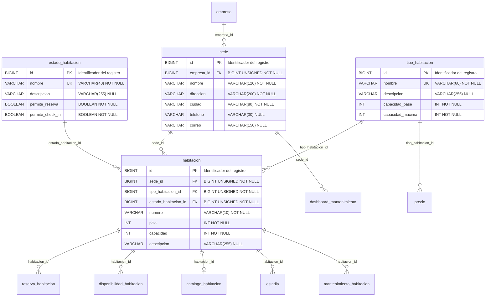
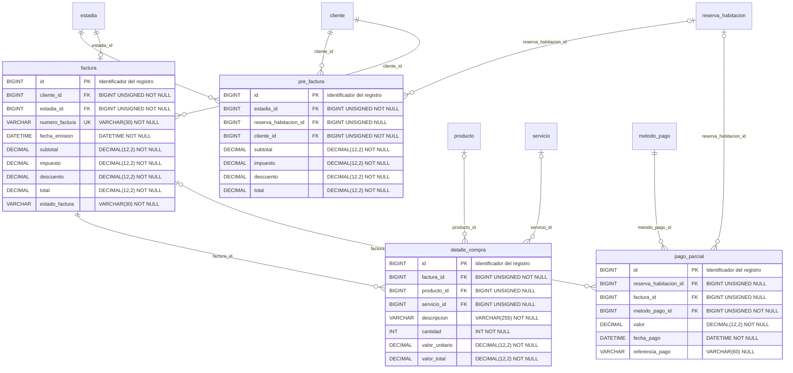
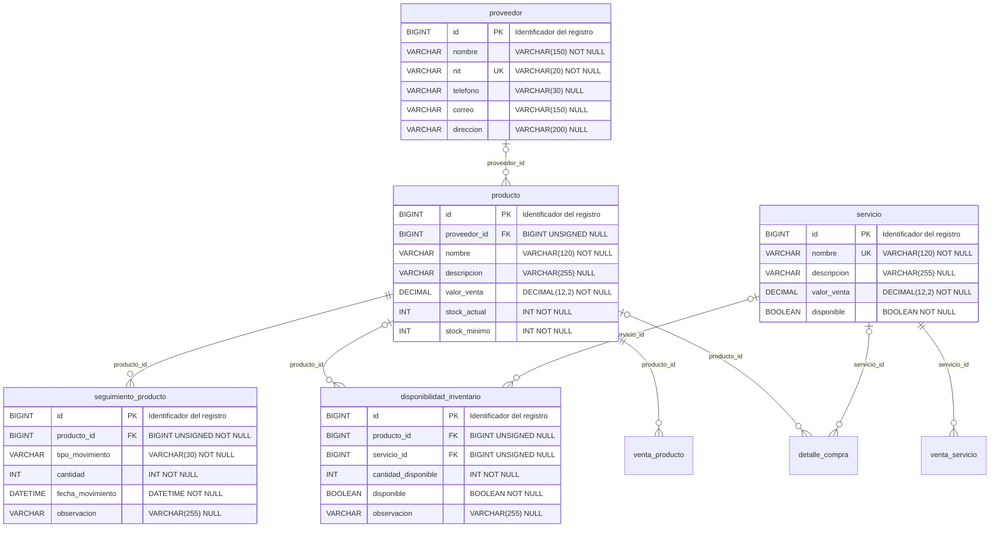
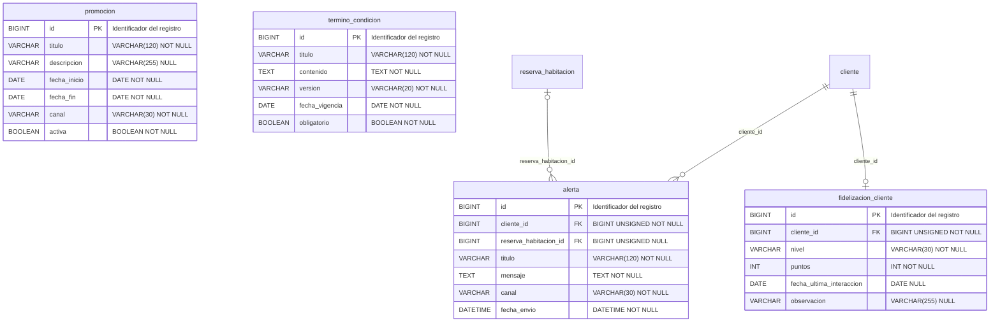
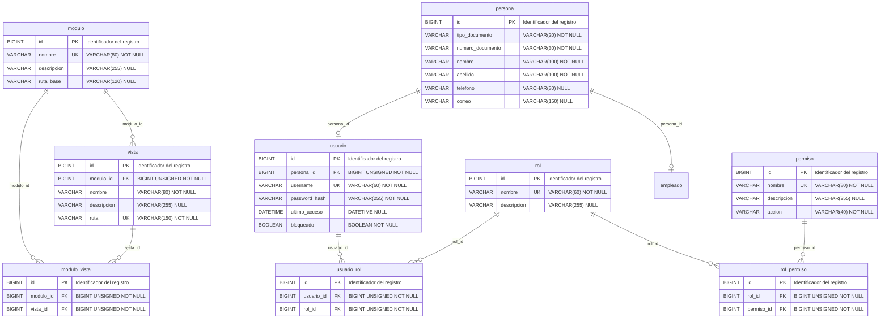
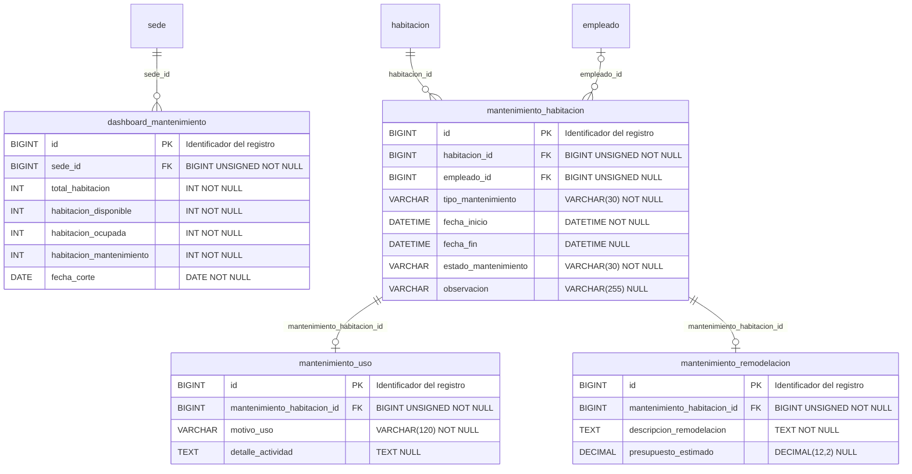

# Diagrama EER del sistema de hotelería (notación Mermaid)

Evidencia **GA3-220501096-AA1-EV01**. Los diagramas de esta página se
renderizan directamente en GitHub y reproducen el mismo modelo que se
construye en la herramienta CASE a partir de
`modelo_conceptual_hotel.sql`.

- Entidades: **46** | Relaciones: **55**
- Notación: pata de gallo. `||` = uno y solo uno, `|o` = cero o uno,
  `o{` = cero o muchos.

## 1. Diagrama general (entidades y relaciones)

```mermaid
erDiagram
    alerta {
        BIGINT id PK
    }
    cancelacion_habitacion {
        BIGINT id PK
    }
    catalogo_habitacion {
        BIGINT id PK
    }
    check_in {
        BIGINT id PK
    }
    check_out {
        BIGINT id PK
    }
    cliente {
        BIGINT id PK
    }
    dashboard_mantenimiento {
        BIGINT id PK
    }
    detalle_compra {
        BIGINT id PK
    }
    disponibilidad_habitacion {
        BIGINT id PK
    }
    disponibilidad_inventario {
        BIGINT id PK
    }
    empleado {
        BIGINT id PK
    }
    empresa {
        BIGINT id PK
    }
    estadia {
        BIGINT id PK
    }
    estado_habitacion {
        BIGINT id PK
    }
    factura {
        BIGINT id PK
    }
    fidelizacion_cliente {
        BIGINT id PK
    }
    habitacion {
        BIGINT id PK
    }
    informacion_legal {
        BIGINT id PK
    }
    mantenimiento_habitacion {
        BIGINT id PK
    }
    mantenimiento_remodelacion {
        BIGINT id PK
    }
    mantenimiento_uso {
        BIGINT id PK
    }
    metodo_pago {
        BIGINT id PK
    }
    modulo {
        BIGINT id PK
    }
    modulo_vista {
        BIGINT id PK
    }
    pago_parcial {
        BIGINT id PK
    }
    permiso {
        BIGINT id PK
    }
    persona {
        BIGINT id PK
    }
    pre_factura {
        BIGINT id PK
    }
    precio {
        BIGINT id PK
    }
    producto {
        BIGINT id PK
    }
    promocion {
        BIGINT id PK
    }
    proveedor {
        BIGINT id PK
    }
    reserva_habitacion {
        BIGINT id PK
    }
    rol {
        BIGINT id PK
    }
    rol_permiso {
        BIGINT id PK
    }
    sede {
        BIGINT id PK
    }
    seguimiento_producto {
        BIGINT id PK
    }
    servicio {
        BIGINT id PK
    }
    termino_condicion {
        BIGINT id PK
    }
    tipo_dia {
        BIGINT id PK
    }
    tipo_habitacion {
        BIGINT id PK
    }
    usuario {
        BIGINT id PK
    }
    usuario_rol {
        BIGINT id PK
    }
    venta_producto {
        BIGINT id PK
    }
    venta_servicio {
        BIGINT id PK
    }
    vista {
        BIGINT id PK
    }
    tipo_habitacion ||--o{ precio : "tipo_habitacion_id"
    tipo_dia ||--o{ precio : "tipo_dia_id"
    empresa ||--o{ informacion_legal : "empresa_id"
    persona ||--o| empleado : "persona_id"
    empresa ||--o{ sede : "empresa_id"
    sede ||--o{ habitacion : "sede_id"
    tipo_habitacion ||--o{ habitacion : "tipo_habitacion_id"
    estado_habitacion ||--o{ habitacion : "estado_habitacion_id"
    cliente ||--o{ reserva_habitacion : "cliente_id"
    habitacion ||--o{ reserva_habitacion : "habitacion_id"
    reserva_habitacion ||--o| cancelacion_habitacion : "reserva_habitacion_id"
    habitacion ||--o{ disponibilidad_habitacion : "habitacion_id"
    habitacion ||--o| catalogo_habitacion : "habitacion_id"
    reserva_habitacion ||--o| check_in : "reserva_habitacion_id"
    empleado ||--o{ check_in : "empleado_id"
    reserva_habitacion ||--o| estadia : "reserva_habitacion_id"
    cliente ||--o{ estadia : "cliente_id"
    habitacion ||--o{ estadia : "habitacion_id"
    estadia ||--o| check_out : "estadia_id"
    empleado ||--o{ check_out : "empleado_id"
    estadia ||--o{ venta_producto : "estadia_id"
    producto ||--o{ venta_producto : "producto_id"
    estadia ||--o{ venta_servicio : "estadia_id"
    servicio ||--o{ venta_servicio : "servicio_id"
    estadia ||--o{ pre_factura : "estadia_id"
    reserva_habitacion |o--o{ pre_factura : "reserva_habitacion_id"
    cliente ||--o{ pre_factura : "cliente_id"
    cliente ||--o{ factura : "cliente_id"
    estadia ||--o| factura : "estadia_id"
    factura ||--o{ detalle_compra : "factura_id"
    producto |o--o{ detalle_compra : "producto_id"
    servicio |o--o{ detalle_compra : "servicio_id"
    reserva_habitacion |o--o{ pago_parcial : "reserva_habitacion_id"
    factura |o--o{ pago_parcial : "factura_id"
    metodo_pago ||--o{ pago_parcial : "metodo_pago_id"
    proveedor |o--o{ producto : "proveedor_id"
    producto ||--o{ seguimiento_producto : "producto_id"
    producto |o--o{ disponibilidad_inventario : "producto_id"
    servicio |o--o{ disponibilidad_inventario : "servicio_id"
    cliente ||--o{ alerta : "cliente_id"
    reserva_habitacion |o--o{ alerta : "reserva_habitacion_id"
    cliente ||--o| fidelizacion_cliente : "cliente_id"
    persona ||--o| usuario : "persona_id"
    modulo ||--o{ vista : "modulo_id"
    usuario ||--o{ usuario_rol : "usuario_id"
    rol ||--o{ usuario_rol : "rol_id"
    rol ||--o{ rol_permiso : "rol_id"
    permiso ||--o{ rol_permiso : "permiso_id"
    modulo ||--o{ modulo_vista : "modulo_id"
    vista ||--o{ modulo_vista : "vista_id"
    habitacion ||--o{ mantenimiento_habitacion : "habitacion_id"
    empleado |o--o{ mantenimiento_habitacion : "empleado_id"
    mantenimiento_habitacion ||--o| mantenimiento_uso : "mantenimiento_habitacion_id"
    mantenimiento_habitacion ||--o| mantenimiento_remodelacion : "mantenimiento_habitacion_id"
    sede ||--o{ dashboard_mantenimiento : "sede_id"
```

## Módulo 1. Parametrización

```mermaid
erDiagram
    cliente {
        BIGINT id PK "Identificador del registro"
        VARCHAR tipo_documento  "VARCHAR(20) NOT NULL"
        VARCHAR numero_documento  "VARCHAR(30) NOT NULL"
        VARCHAR nombre  "VARCHAR(100) NOT NULL"
        VARCHAR apellido  "VARCHAR(100) NOT NULL"
        VARCHAR telefono  "VARCHAR(30) NULL"
        VARCHAR correo UK "VARCHAR(150) NULL"
        VARCHAR direccion  "VARCHAR(200) NULL"
    }
    empleado {
        BIGINT id PK "Identificador del registro"
        BIGINT persona_id FK "BIGINT UNSIGNED NOT NULL"
        VARCHAR cargo  "VARCHAR(80) NOT NULL"
        DATE fecha_ingreso  "DATE NOT NULL"
        VARCHAR telefono_laboral  "VARCHAR(30) NULL"
        VARCHAR correo_laboral UK "VARCHAR(150) NULL"
    }
    empresa {
        BIGINT id PK "Identificador del registro"
        VARCHAR nombre  "VARCHAR(150) NOT NULL"
        VARCHAR nit UK "VARCHAR(20) NOT NULL"
        VARCHAR razon_social  "VARCHAR(200) NOT NULL"
        VARCHAR telefono  "VARCHAR(30) NULL"
        VARCHAR correo  "VARCHAR(150) NULL"
        VARCHAR direccion  "VARCHAR(200) NULL"
        VARCHAR sitio_web  "VARCHAR(150) NULL"
    }
    informacion_legal {
        BIGINT id PK "Identificador del registro"
        BIGINT empresa_id FK "BIGINT UNSIGNED NOT NULL"
        VARCHAR tipo_documento_legal  "VARCHAR(50) NOT NULL"
        VARCHAR numero_documento_legal  "VARCHAR(50) NOT NULL"
        VARCHAR descripcion  "VARCHAR(255) NULL"
        DATE fecha_expedicion  "DATE NOT NULL"
        DATE fecha_vencimiento  "DATE NULL"
    }
    metodo_pago {
        BIGINT id PK "Identificador del registro"
        VARCHAR nombre UK "VARCHAR(60) NOT NULL"
        VARCHAR descripcion  "VARCHAR(255) NULL"
        BOOLEAN requiere_referencia  "BOOLEAN NOT NULL"
        BOOLEAN permite_pago_parcial  "BOOLEAN NOT NULL"
    }
    precio {
        BIGINT id PK "Identificador del registro"
        BIGINT tipo_habitacion_id FK "BIGINT UNSIGNED NOT NULL"
        BIGINT tipo_dia_id FK "BIGINT UNSIGNED NOT NULL"
        DECIMAL valor  "DECIMAL(12,2) NOT NULL"
        DATE fecha_inicio  "DATE NOT NULL"
        DATE fecha_fin  "DATE NULL"
        VARCHAR condicion  "VARCHAR(255) NULL"
    }
    tipo_dia {
        BIGINT id PK "Identificador del registro"
        VARCHAR nombre UK "VARCHAR(60) NOT NULL"
        VARCHAR descripcion  "VARCHAR(255) NULL"
        DATE fecha  "DATE NULL"
        BOOLEAN aplica_temporada  "BOOLEAN NOT NULL"
        BOOLEAN aplica_feriado  "BOOLEAN NOT NULL"
        BOOLEAN aplica_especial  "BOOLEAN NOT NULL"
    }
    tipo_dia ||--o{ precio : "tipo_dia_id"
    empresa ||--o{ informacion_legal : "empresa_id"
    tipo_habitacion ||--o{ precio : "tipo_habitacion_id"
    persona ||--o| empleado : "persona_id"
    empresa ||--o{ sede : "empresa_id"
    cliente ||--o{ reserva_habitacion : "cliente_id"
    empleado ||--o{ check_in : "empleado_id"
    cliente ||--o{ estadia : "cliente_id"
    empleado ||--o{ check_out : "empleado_id"
    cliente ||--o{ pre_factura : "cliente_id"
    cliente ||--o{ factura : "cliente_id"
    metodo_pago ||--o{ pago_parcial : "metodo_pago_id"
    cliente ||--o{ alerta : "cliente_id"
    cliente ||--o| fidelizacion_cliente : "cliente_id"
    empleado |o--o{ mantenimiento_habitacion : "empleado_id"
```

> Relaciones con otros módulos: `precio` (1. Parametrización) &rarr; `tipo_habitacion` (2. Distribución); `empleado` (1. Parametrización) &rarr; `persona` (7. Seguridad); `sede` (2. Distribución) &rarr; `empresa` (1. Parametrización); `reserva_habitacion` (3. Prestación de servicio) &rarr; `cliente` (1. Parametrización); `check_in` (3. Prestación de servicio) &rarr; `empleado` (1. Parametrización); `estadia` (3. Prestación de servicio) &rarr; `cliente` (1. Parametrización); `check_out` (3. Prestación de servicio) &rarr; `empleado` (1. Parametrización); `pre_factura` (4. Facturación) &rarr; `cliente` (1. Parametrización); `factura` (4. Facturación) &rarr; `cliente` (1. Parametrización); `pago_parcial` (4. Facturación) &rarr; `metodo_pago` (1. Parametrización); `alerta` (6. Notificación) &rarr; `cliente` (1. Parametrización); `fidelizacion_cliente` (6. Notificación) &rarr; `cliente` (1. Parametrización); `mantenimiento_habitacion` (8. Mantenimiento) &rarr; `empleado` (1. Parametrización).

## Módulo 2. Distribución

> Relaciones con otros módulos: `precio` (1. Parametrización) &rarr; `tipo_habitacion` (2. Distribución); `sede` (2. Distribución) &rarr; `empresa` (1. Parametrización); `reserva_habitacion` (3. Prestación de servicio) &rarr; `habitacion` (2. Distribución); `disponibilidad_habitacion` (3. Prestación de servicio) &rarr; `habitacion` (2. Distribución); `catalogo_habitacion` (3. Prestación de servicio) &rarr; `habitacion` (2. Distribución); `estadia` (3. Prestación de servicio) &rarr; `habitacion` (2. Distribución); `mantenimiento_habitacion` (8. Mantenimiento) &rarr; `habitacion` (2. Distribución); `dashboard_mantenimiento` (8. Mantenimiento) &rarr; `sede` (2. Distribución).

## Módulo 3. Prestación de servicio

```mermaid
erDiagram
    cancelacion_habitacion {
        BIGINT id PK "Identificador del registro"
        BIGINT reserva_habitacion_id FK "BIGINT UNSIGNED NOT NULL"
        VARCHAR motivo  "VARCHAR(255) NOT NULL"
        DATETIME fecha_cancelacion  "DATETIME NOT NULL"
        BOOLEAN aplica_penalidad  "BOOLEAN NOT NULL"
        DECIMAL valor_penalidad  "DECIMAL(12,2) NULL"
    }
    catalogo_habitacion {
        BIGINT id PK "Identificador del registro"
        BIGINT habitacion_id FK "BIGINT UNSIGNED NOT NULL"
        VARCHAR titulo  "VARCHAR(120) NOT NULL"
        TEXT descripcion  "TEXT NULL"
        DECIMAL precio_base  "DECIMAL(12,2) NOT NULL"
        BOOLEAN visible  "BOOLEAN NOT NULL"
    }
    check_in {
        BIGINT id PK "Identificador del registro"
        BIGINT reserva_habitacion_id FK "BIGINT UNSIGNED NOT NULL"
        BIGINT empleado_id FK "BIGINT UNSIGNED NOT NULL"
        DATETIME fecha_hora_ingreso  "DATETIME NOT NULL"
        VARCHAR observacion  "VARCHAR(255) NULL"
    }
    check_out {
        BIGINT id PK "Identificador del registro"
        BIGINT estadia_id FK "BIGINT UNSIGNED NOT NULL"
        BIGINT empleado_id FK "BIGINT UNSIGNED NOT NULL"
        DATETIME fecha_hora_salida  "DATETIME NOT NULL"
        VARCHAR observacion  "VARCHAR(255) NULL"
        DECIMAL valor_total  "DECIMAL(12,2) NOT NULL"
    }
    disponibilidad_habitacion {
        BIGINT id PK "Identificador del registro"
        BIGINT habitacion_id FK "BIGINT UNSIGNED NOT NULL"
        DATE fecha_inicio  "DATE NOT NULL"
        DATE fecha_fin  "DATE NOT NULL"
        BOOLEAN disponible  "BOOLEAN NOT NULL"
        VARCHAR motivo_no_disponible  "VARCHAR(255) NULL"
    }
    estadia {
        BIGINT id PK "Identificador del registro"
        BIGINT reserva_habitacion_id FK "BIGINT UNSIGNED NOT NULL"
        BIGINT cliente_id FK "BIGINT UNSIGNED NOT NULL"
        BIGINT habitacion_id FK "BIGINT UNSIGNED NOT NULL"
        DATETIME fecha_inicio  "DATETIME NOT NULL"
        DATETIME fecha_fin  "DATETIME NULL"
        VARCHAR estado_estadia  "VARCHAR(30) NOT NULL"
    }
    reserva_habitacion {
        BIGINT id PK "Identificador del registro"
        BIGINT cliente_id FK "BIGINT UNSIGNED NOT NULL"
        BIGINT habitacion_id FK "BIGINT UNSIGNED NOT NULL"
        DATE fecha_inicio  "DATE NOT NULL"
        DATE fecha_fin  "DATE NOT NULL"
        INT cantidad_persona  "INT NOT NULL"
        VARCHAR estado_reserva  "VARCHAR(30) NOT NULL"
        DECIMAL valor_estimado  "DECIMAL(12,2) NULL"
    }
    venta_producto {
        BIGINT id PK "Identificador del registro"
        BIGINT estadia_id FK "BIGINT UNSIGNED NOT NULL"
        BIGINT producto_id FK "BIGINT UNSIGNED NOT NULL"
        INT cantidad  "INT NOT NULL"
        DECIMAL valor_unitario  "DECIMAL(12,2) NOT NULL"
        DECIMAL valor_total  "DECIMAL(12,2) NOT NULL"
    }
    venta_servicio {
        BIGINT id PK "Identificador del registro"
        BIGINT estadia_id FK "BIGINT UNSIGNED NOT NULL"
        BIGINT servicio_id FK "BIGINT UNSIGNED NOT NULL"
        INT cantidad  "INT NOT NULL"
        DECIMAL valor_unitario  "DECIMAL(12,2) NOT NULL"
        DECIMAL valor_total  "DECIMAL(12,2) NOT NULL"
    }
    reserva_habitacion ||--o| cancelacion_habitacion : "reserva_habitacion_id"
    reserva_habitacion ||--o| check_in : "reserva_habitacion_id"
    reserva_habitacion ||--o| estadia : "reserva_habitacion_id"
    estadia ||--o| check_out : "estadia_id"
    estadia ||--o{ venta_producto : "estadia_id"
    estadia ||--o{ venta_servicio : "estadia_id"
    cliente ||--o{ reserva_habitacion : "cliente_id"
    habitacion ||--o{ reserva_habitacion : "habitacion_id"
    habitacion ||--o{ disponibilidad_habitacion : "habitacion_id"
    habitacion ||--o| catalogo_habitacion : "habitacion_id"
    empleado ||--o{ check_in : "empleado_id"
    cliente ||--o{ estadia : "cliente_id"
    habitacion ||--o{ estadia : "habitacion_id"
    empleado ||--o{ check_out : "empleado_id"
    producto ||--o{ venta_producto : "producto_id"
    servicio ||--o{ venta_servicio : "servicio_id"
    estadia ||--o{ pre_factura : "estadia_id"
    reserva_habitacion |o--o{ pre_factura : "reserva_habitacion_id"
    estadia ||--o| factura : "estadia_id"
    reserva_habitacion |o--o{ pago_parcial : "reserva_habitacion_id"
    reserva_habitacion |o--o{ alerta : "reserva_habitacion_id"
```

> Relaciones con otros módulos: `reserva_habitacion` (3. Prestación de servicio) &rarr; `cliente` (1. Parametrización); `reserva_habitacion` (3. Prestación de servicio) &rarr; `habitacion` (2. Distribución); `disponibilidad_habitacion` (3. Prestación de servicio) &rarr; `habitacion` (2. Distribución); `catalogo_habitacion` (3. Prestación de servicio) &rarr; `habitacion` (2. Distribución); `check_in` (3. Prestación de servicio) &rarr; `empleado` (1. Parametrización); `estadia` (3. Prestación de servicio) &rarr; `cliente` (1. Parametrización); `estadia` (3. Prestación de servicio) &rarr; `habitacion` (2. Distribución); `check_out` (3. Prestación de servicio) &rarr; `empleado` (1. Parametrización); `venta_producto` (3. Prestación de servicio) &rarr; `producto` (5. Inventario); `venta_servicio` (3. Prestación de servicio) &rarr; `servicio` (5. Inventario); `pre_factura` (4. Facturación) &rarr; `estadia` (3. Prestación de servicio); `pre_factura` (4. Facturación) &rarr; `reserva_habitacion` (3. Prestación de servicio); `factura` (4. Facturación) &rarr; `estadia` (3. Prestación de servicio); `pago_parcial` (4. Facturación) &rarr; `reserva_habitacion` (3. Prestación de servicio); `alerta` (6. Notificación) &rarr; `reserva_habitacion` (3. Prestación de servicio).

## Módulo 4. Facturación

> Relaciones con otros módulos: `pre_factura` (4. Facturación) &rarr; `estadia` (3. Prestación de servicio); `pre_factura` (4. Facturación) &rarr; `reserva_habitacion` (3. Prestación de servicio); `pre_factura` (4. Facturación) &rarr; `cliente` (1. Parametrización); `factura` (4. Facturación) &rarr; `cliente` (1. Parametrización); `factura` (4. Facturación) &rarr; `estadia` (3. Prestación de servicio); `detalle_compra` (4. Facturación) &rarr; `producto` (5. Inventario); `detalle_compra` (4. Facturación) &rarr; `servicio` (5. Inventario); `pago_parcial` (4. Facturación) &rarr; `reserva_habitacion` (3. Prestación de servicio); `pago_parcial` (4. Facturación) &rarr; `metodo_pago` (1. Parametrización).

## Módulo 5. Inventario

> Relaciones con otros módulos: `venta_producto` (3. Prestación de servicio) &rarr; `producto` (5. Inventario); `venta_servicio` (3. Prestación de servicio) &rarr; `servicio` (5. Inventario); `detalle_compra` (4. Facturación) &rarr; `producto` (5. Inventario); `detalle_compra` (4. Facturación) &rarr; `servicio` (5. Inventario).

## Módulo 6. Notificación

> Relaciones con otros módulos: `alerta` (6. Notificación) &rarr; `cliente` (1. Parametrización); `alerta` (6. Notificación) &rarr; `reserva_habitacion` (3. Prestación de servicio); `fidelizacion_cliente` (6. Notificación) &rarr; `cliente` (1. Parametrización).

## Módulo 7. Seguridad

> Relaciones con otros módulos: `empleado` (1. Parametrización) &rarr; `persona` (7. Seguridad).

## Módulo 8. Mantenimiento

> Relaciones con otros módulos: `mantenimiento_habitacion` (8. Mantenimiento) &rarr; `habitacion` (2. Distribución); `mantenimiento_habitacion` (8. Mantenimiento) &rarr; `empleado` (1. Parametrización); `dashboard_mantenimiento` (8. Mantenimiento) &rarr; `sede` (2. Distribución).
