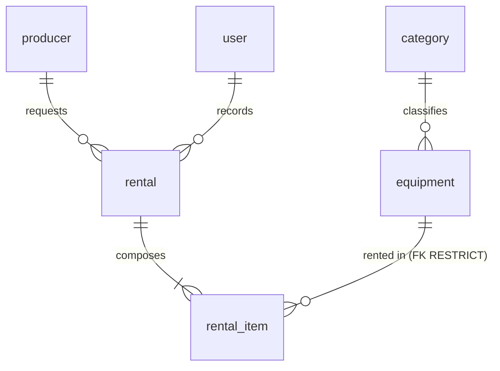

# Data model - film-gear

**The only place the data model lives.** An implementer does not need to open the code or connect to the engine
to know what exists, of what type and under which rule.

- Reference engine: PostgreSQL 16. Schema `filmgear`. Server in UTC.
- Governed by [`constitution.md`](constitution.md) and [`spec.md`](spec.md). If anything contradicts this
  document, this document wins.

Every rule carries one of **three marks**: **engine** (the database enforces it), **domain only** (code alone),
**pending (T-xx)** (that task in [`tasks.md`](tasks.md) will apply it).

---

## 0. Naming convention

| Element | Convention | Example |
|---|---|---|
| Table | `snake_case`, English, **singular** | `rental_item` |
| Column | `snake_case`, English, singular, ASCII | `due_at` |
| Hand-written constraint | `ck_{table}_{rule}` | `ck_equipment_available_range` |
| Schema | `filmgear` | `filmgear.rental` |

`user` is written `filmgear."user"` in hand-written SQL; the query builder quotes it on its own.

## 1. Glossary

| Term | Definition | Where it lives |
|---|---|---|
| **Equipment** | A catalogue model, with brand, model code, category, units and an optional photo | `equipment` |
| **Category** | A fixed classification of five, seeded, never maintained | `category` |
| **Unit** | A physical copy of a piece of equipment. Counted, not identified | `equipment.total_units`, `equipment.available_units` |
| **Producer** | The party that rents. Does not sign in | `producer` |
| **Rental** | A settled fact: who asked, who recorded it and when | `rental` |
| **Rental line** | One piece of equipment inside a rental, with its due date and its return | `rental_item` |
| **Rental state** | `open`, `overdue` or `closed`. **Computed, never stored** | no column |
| **User** | An internal operator with the `admin` or `advisor` role | `user` |
| **Frozen** | A copy of the value at the instant of the rental; does not follow the catalogue | `rental_item.equipment_name`, `model_code`, `category_name` |

## 2. Entities and relationships

Six entities, six tables. There is no report table, no rate table and no audit table.

## 3. Physical model

No column carries a `DEFAULT`: the domain supplies the values.

**`category`** - read-only seed.

| Column | Type | Nullable | Note |
|---|---|---|---|
| `id` | `uuid` | no | PK. Literal identifiers (see section 9) |
| `name` | `varchar(120)` | no | Unique |

**`equipment`**

| Column | Type | Nullable | Note |
|---|---|---|---|
| `id` | `uuid` | no | PK |
| `name` | `varchar(200)` | no | Trimmed by the domain |
| `brand` | `varchar(120)` | no | |
| `model_code` | `varchar(20)` | no | 4 to 20 characters of `[A-Z0-9-]`. Unique among active equipment (partial index) |
| `category_id` | `uuid` | no | Restrictive FK to `category` |
| `total_units` | `integer` | no | >= 1 |
| `available_units` | `integer` | no | Between 0 and `total_units` |
| `photo_key` | `varchar(512)` | **yes** | Opaque key; never a path, never bytes, never an empty string |
| `deleted_at` | `timestamptz` | yes | Soft delete. Null means active |

**`producer`**

| Column | Type | Nullable | Note |
|---|---|---|---|
| `id` | `uuid` | no | PK |
| `full_name` | `varchar(200)` | no | |
| `document_number` | `varchar(30)` | no | Unique |

**`rental`**

| Column | Type | Nullable | Note |
|---|---|---|---|
| `id` | `uuid` | no | PK |
| `producer_id` | `uuid` | no | Restrictive FK to `producer` |
| `rented_by_user_id` | `uuid` | no | Restrictive FK to `user` |
| `rented_at` | `timestamptz` | no | The instant of the rental |

**`rental_item`**

| Column | Type | Nullable | Note |
|---|---|---|---|
| `id` | `uuid` | no | PK |
| `rental_id` | `uuid` | no | FK with `ON DELETE CASCADE` |
| `equipment_id` | `uuid` | no | Restrictive FK to `equipment` |
| `equipment_name` | `varchar(200)` | no | Frozen; same width as `equipment.name` |
| `model_code` | `varchar(20)` | no | Frozen |
| `category_name` | `varchar(120)` | no | Frozen; **deliberately without a FK** |
| `due_at` | `timestamptz` | no | `rented_at` + 4 days, computed by the domain |
| `returned_at` | `timestamptz` | **yes** | Null until the line comes back |

**`user`**

| Column | Type | Nullable | Note |
|---|---|---|---|
| `id` | `uuid` | no | PK |
| `username` | `varchar(120)` | no | Unique, lowercase, trimmed |
| `password_hash` | `varchar(512)` | no | Never indexed |
| `role` | `varchar(40)` | no | `admin` or `advisor` |

Cross-cutting rules: **every timestamp is `timestamptz`**; there are **no audit columns**
(`created_at`/`updated_at`) because no requirement asks for them.
