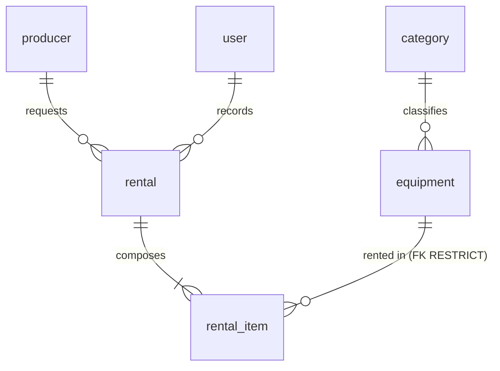

# Data model - film-gear

**The only place the data model lives.** An implementer does not need to open the code or connect to the engine
to know what exists, of what type and under which rule.

- Reference engine: PostgreSQL 16. Schema `filmgear`. Server in UTC.
- Governed by [`constitution.md`](constitution.md) and [`spec.md`](spec.md). If anything contradicts this
  document, this document wins.

Every rule carries one of **three marks**: **engine** (the database enforces it), **domain only** (code alone),
**pending (T-xx)** (that task in [`tasks.md`](tasks.md) will apply it).

---

## 0. Naming convention

| Element | Convention | Example |
|---|---|---|
| Table | `snake_case`, English, **singular** | `rental_item` |
| Column | `snake_case`, English, singular, ASCII | `due_at` |
| Hand-written constraint | `ck_{table}_{rule}` | `ck_equipment_available_range` |
| Schema | `filmgear` | `filmgear.rental` |

`user` is written `filmgear."user"` in hand-written SQL; the query builder quotes it on its own.

## 1. Glossary

| Term | Definition | Where it lives |
|---|---|---|
| **Equipment** | A catalogue model, with brand, model code, category, units and an optional photo | `equipment` |
| **Category** | A fixed classification of five, seeded, never maintained | `category` |
| **Unit** | A physical copy of a piece of equipment. Counted, not identified | `equipment.total_units`, `equipment.available_units` |
| **Producer** | The party that rents. Does not sign in | `producer` |
| **Rental** | A settled fact: who asked, who recorded it and when | `rental` |
| **Rental line** | One piece of equipment inside a rental, with its due date and its return | `rental_item` |
| **Rental state** | `open`, `overdue` or `closed`. **Computed, never stored** | no column |
| **User** | An internal operator with the `admin` or `advisor` role | `user` |
| **Frozen** | A copy of the value at the instant of the rental; does not follow the catalogue | `rental_item.equipment_name`, `model_code`, `category_name` |

## 2. Entities and relationships

Six entities, six tables. There is no report table, no rate table and no audit table.

## 3. Physical model

No column carries a `DEFAULT`: the domain supplies the values.

**`category`** - read-only seed.

| Column | Type | Nullable | Note |
|---|---|---|---|
| `id` | `uuid` | no | PK. Literal identifiers (see section 9) |
| `name` | `varchar(120)` | no | Unique |

**`equipment`**

| Column | Type | Nullable | Note |
|---|---|---|---|
| `id` | `uuid` | no | PK |
| `name` | `varchar(200)` | no | Trimmed by the domain |
| `brand` | `varchar(120)` | no | |
| `model_code` | `varchar(20)` | no | 4 to 20 characters of `[A-Z0-9-]`. Unique among active equipment (partial index) |
| `category_id` | `uuid` | no | Restrictive FK to `category` |
| `total_units` | `integer` | no | >= 1 |
| `available_units` | `integer` | no | Between 0 and `total_units` |
| `photo_key` | `varchar(512)` | **yes** | Opaque key; never a path, never bytes, never an empty string |
| `deleted_at` | `timestamptz` | yes | Soft delete. Null means active |

**`producer`**

| Column | Type | Nullable | Note |
|---|---|---|---|
| `id` | `uuid` | no | PK |
| `full_name` | `varchar(200)` | no | |
| `document_number` | `varchar(30)` | no | Unique |

**`rental`**

| Column | Type | Nullable | Note |
|---|---|---|---|
| `id` | `uuid` | no | PK |
| `producer_id` | `uuid` | no | Restrictive FK to `producer` |
| `rented_by_user_id` | `uuid` | no | Restrictive FK to `user` |
| `rented_at` | `timestamptz` | no | The instant of the rental |

**`rental_item`**

| Column | Type | Nullable | Note |
|---|---|---|---|
| `id` | `uuid` | no | PK |
| `rental_id` | `uuid` | no | FK with `ON DELETE CASCADE` |
| `equipment_id` | `uuid` | no | Restrictive FK to `equipment` |
| `equipment_name` | `varchar(200)` | no | Frozen; same width as `equipment.name` |
| `model_code` | `varchar(20)` | no | Frozen |
| `category_name` | `varchar(120)` | no | Frozen; **deliberately without a FK** |
| `due_at` | `timestamptz` | no | `rented_at` + 4 days, computed by the domain |
| `returned_at` | `timestamptz` | **yes** | Null until the line comes back |

**`user`**

| Column | Type | Nullable | Note |
|---|---|---|---|
| `id` | `uuid` | no | PK |
| `username` | `varchar(120)` | no | Unique, lowercase, trimmed |
| `password_hash` | `varchar(512)` | no | Never indexed |
| `role` | `varchar(40)` | no | `admin` or `advisor` |

Cross-cutting rules: **every timestamp is `timestamptz`**; there are **no audit columns**
(`created_at`/`updated_at`) because no requirement asks for them.

## 4. Constraints and indexes: where each rule lives

| Rule | Object | Mark |
|---|---|---|
| Primary keys of the six tables | `PK_*` | **engine** |
| `category.name` unique | unique index | **engine** |
| `producer.document_number` unique | unique index | **engine** |
| `user.username` unique | unique index | **engine** |
| `model_code` unique among active rows | partial unique index `WHERE deleted_at IS NULL` | **engine** |
| `equipment.category_id` to `category.id` RESTRICT | FK | **engine** |
| `rental.producer_id` to `producer.id` RESTRICT | FK | **engine** |
| `rental.rented_by_user_id` to `user.id` RESTRICT | FK | **engine** |
| `rental_item.rental_id` to `rental.id` CASCADE | FK | **engine** |
| `rental_item.equipment_id` to `equipment.id` RESTRICT | FK | **engine** |
| `0 <= available_units <= total_units` | `ck_equipment_available_range` | **engine** - last line of defence for concurrency |
| `total_units >= 1` | `ck_equipment_total_positive` | **engine** |
| `role` in (`admin`,`advisor`) | `ck_user_role` | **engine** |
| Unique `(rental_id, equipment_id)` | unique index | **engine** |
| At most 2 items out per producer | - | **domain only** (not expressible in a `CHECK`) |
| A producer with overdue items cannot rent | - | **domain only** |
| Taking a unit and creating a line are one operation | - | **domain only** (one transaction) |
| A rental has 1 or 2 lines | - | **domain only** |
| Rentals and returns immutable except `returned_at` | - | **domain only** (by absence of an operation) |

**No rule is left pending.** The three `CHECK` constraints land in the initial migration, not in a later one: a
rule the engine can enforce and does not protects the application, not the data (article VI).

Access indexes: `equipment (category_id, name)` partial over active rows; `rental (rented_at)`;
`rental_item (equipment_id)`; `rental_item (due_at) WHERE returned_at IS NULL` for overdue lookups.

## 5. Foreign key policy

| # | FK | `ON DELETE` | Why |
|---|---|---|---|
| FK-1 | `equipment.category_id` | RESTRICT | A category with equipment is not deleted |
| FK-2 | `rental_item.rental_id` | CASCADE | Composition: a line does not live without its rental (never fires: rentals are not deleted) |
| FK-3 | `rental_item.equipment_id` | RESTRICT | Last line of defence: a manual delete cannot orphan the history |
| FK-4 | `rental.producer_id` | RESTRICT | The producer on a rental does not disappear |
| FK-5 | `rental.rented_by_user_id` | RESTRICT | Authorship is accounting data |

`ON UPDATE NO ACTION` on all of them: keys are application UUIDs and never change.

## 6. Access patterns

| # | Pattern | Frequency |
|---|---|---|
| Q1 | Search equipment (text, category, active, ordered by name, paginated) | High |
| Q2 | Equipment by id | High |
| Q3 | Equipment by a batch of ids (before renting) | High, point of contention |
| Q4 | List categories | High |
| Q5 | Rental with its lines | Medium |
| Q6 | Rentals by range, state and producer | High |
| Q7 | Unreturned lines of a producer (count and overdue) | High, on every rental |
| Q8 | Global overdue list | Medium |
| Q9 | Report: most requested over a range | High, the most expensive |
| Q10 | User by name | High, on every sign-in |

## 7. Privacy and retention

| Table | Attribute | Classification | Handling |
|---|---|---|---|
| `user` | `username` | Personal data | Restricted access |
| `user` | `password_hash` | **Secret** | Never in logs or responses; never indexed |
| `producer` | `full_name`, `document_number` | **Personal data** | `admin` and `advisor` only; **never** in the report or a public endpoint |
| `rental`, `rental_item` | all | Commercial; `producer_id` is indirect personal data | Indefinite retention |
| `equipment`, `category` | all | Public | Soft delete / no deletion |

The report aggregates by equipment: it **exposes no producers and no advisors**.

**Retention:** rentals and lines are never deleted; equipment is only soft deleted; the photo binary is the
**only** data physically removed. Mandatory order: null `photo_key` and commit the transaction first, then delete
the binary.

## 8. Auditing

The system carries **no** `created_at`/`updated_at`. Business instants already have a column: `rental.rented_at`,
`rental_item.returned_at` and `equipment.deleted_at`. If a question like "who changed this name?" ever appears,
the decision goes back to the owner.

## 9. Seeding strategy

The **five categories** ship in the initial migration with fixed identifiers:

| `id` | `name` |
|---|---|
| `11111111-1111-4111-8111-111111111111` | Cámaras |
| `22222222-2222-4222-8222-222222222222` | Lentes |
| `33333333-3333-4333-8333-333333333333` | Drones |
| `44444444-4444-4444-8444-444444444444` | Audio |
| `55555555-5555-4555-8555-555555555555` | Estabilizadores |

The names stay in Spanish because they are **text a user reads**: they appear verbatim in the catalogue and in
the report (article XI).

The **first administrator is not seeded by the database**: the application boot creates it from environment
credentials, because only the hashing port can produce the hash. The demo seeder in `tool` goes through the
**API**, never through direct SQL.
