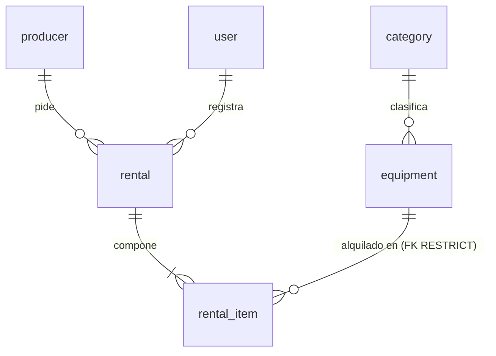

# Modelo de datos — film-gear

**El único sitio donde vive el modelo de datos.** Quien implemente no necesita abrir el código ni conectarse al
motor para saber qué hay, de qué tipo y con qué regla.

- Motor de referencia: PostgreSQL 16. Esquema `filmgear`. Servidor en UTC.
- Rige bajo [`constitution.md`](constitution.md) y [`spec.md`](spec.md). Si algo contradice a este documento, gana
  este documento.

Cada regla lleva una de **tres marcas**: **motor** (la impone la base), **solo dominio** (solo el código),
**pendiente (T-xx)** (la pone esa tarea de [`tasks.md`](tasks.md)).

---

## 0. Convención de nombres

| Elemento | Convención | Ejemplo |
|---|---|---|
| Tabla | `snake_case`, inglés, **singular** | `rental_item` |
| Columna | `snake_case`, inglés, singular, ASCII | `due_at` |
| Restricción escrita a mano | `ck_{tabla}_{regla}` | `ck_equipment_available_range` |
| Esquema | `filmgear` | `filmgear.rental` |

`user` se escribe `filmgear."user"` en SQL a mano; el constructor de consultas lo entrecomilla solo.

## 1. Glosario

| Término | Definición | Dónde vive |
|---|---|---|
| **Equipo** | Modelo del catálogo, con marca, código de modelo, categoría, unidades y foto opcional | `equipment` |
| **Categoría** | Clasificación fija de cinco, sembrada, sin mantenimiento | `category` |
| **Unidad** | Copia física de un equipo. Se cuenta, no se identifica | `equipment.total_units`, `equipment.available_units` |
| **Productor** | Quien alquila. No inicia sesión | `producer` |
| **Alquiler** | Hecho consumado: quién pidió, quién lo registró y cuándo | `rental` |
| **Línea de alquiler** | Un equipo dentro de un alquiler, con su vencimiento y su devolución | `rental_item` |
| **Estado del alquiler** | `open`, `overdue` o `closed`. **Se calcula, no se almacena** | sin columna |
| **Usuario** | Operador interno con rol `admin` o `advisor` | `user` |
| **Congelado** | Copia del valor en el instante del alquiler; no sigue al catálogo | `rental_item.equipment_name`, `model_code`, `category_name` |

## 2. Entidades y relaciones

Seis entidades, seis tablas. No hay tabla de reporte, de tarifas ni de auditoría.

## 3. Modelo físico

Ninguna columna lleva `DEFAULT`: los valores los pone el dominio.

**`category`** — semilla de solo lectura.

| Columna | Tipo | Nulable | Nota |
|---|---|---|---|
| `id` | `uuid` | no | PK. Identificadores literales (ver §9) |
| `name` | `varchar(120)` | no | Único |

**`equipment`**

| Columna | Tipo | Nulable | Nota |
|---|---|---|---|
| `id` | `uuid` | no | PK |
| `name` | `varchar(200)` | no | Recortado por el dominio |
| `brand` | `varchar(120)` | no | |
| `model_code` | `varchar(20)` | no | De 4 a 20 caracteres `[A-Z0-9-]`. Único entre equipos activos (índice parcial) |
| `category_id` | `uuid` | no | FK restrictiva a `category` |
| `total_units` | `integer` | no | ≥ 1 |
| `available_units` | `integer` | no | Entre 0 y `total_units` |
| `photo_key` | `varchar(512)` | **sí** | Clave opaca; nunca ruta ni bytes; nunca cadena vacía |
| `deleted_at` | `timestamptz` | sí | Baja lógica. Nula = activo |

**`producer`**

| Columna | Tipo | Nulable | Nota |
|---|---|---|---|
| `id` | `uuid` | no | PK |
| `full_name` | `varchar(200)` | no | |
| `document_number` | `varchar(30)` | no | Único |

**`rental`**

| Columna | Tipo | Nulable | Nota |
|---|---|---|---|
| `id` | `uuid` | no | PK |
| `producer_id` | `uuid` | no | FK restrictiva a `producer` |
| `rented_by_user_id` | `uuid` | no | FK restrictiva a `user` |
| `rented_at` | `timestamptz` | no | Instante del alquiler |

**`rental_item`**

| Columna | Tipo | Nulable | Nota |
|---|---|---|---|
| `id` | `uuid` | no | PK |
| `rental_id` | `uuid` | no | FK con `ON DELETE CASCADE` |
| `equipment_id` | `uuid` | no | FK restrictiva a `equipment` |
| `equipment_name` | `varchar(200)` | no | Congelado; mismo ancho que `equipment.name` |
| `model_code` | `varchar(20)` | no | Congelado |
| `category_name` | `varchar(120)` | no | Congelado; **sin FK a propósito** |
| `due_at` | `timestamptz` | no | `rented_at` + 4 días, calculado por el dominio |
| `returned_at` | `timestamptz` | **sí** | Nula mientras no se devuelve |

**`user`**

| Columna | Tipo | Nulable | Nota |
|---|---|---|---|
| `id` | `uuid` | no | PK |
| `username` | `varchar(120)` | no | Único, minúsculas, recortado |
| `password_hash` | `varchar(512)` | no | Nunca se indexa |
| `role` | `varchar(40)` | no | `admin` o `advisor` |

Reglas transversales: **todas las marcas de tiempo son `timestamptz`**; **no hay columnas de auditoría**
(`created_at`/`updated_at`) porque ningún requisito las pide.
